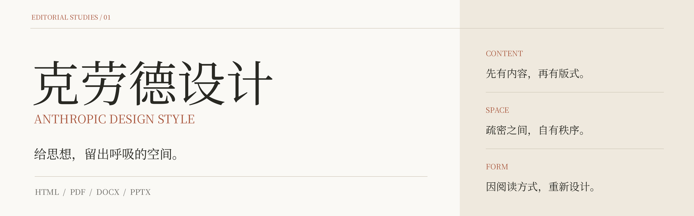
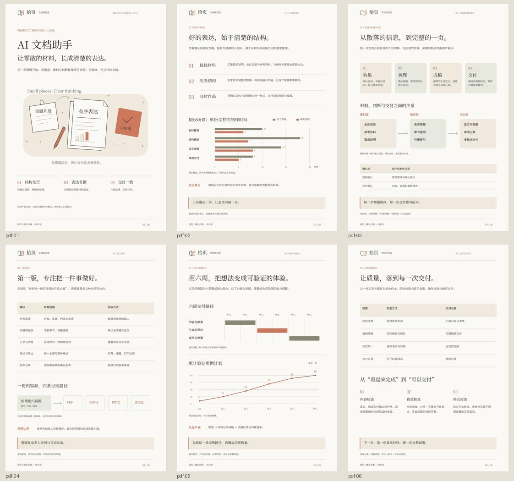
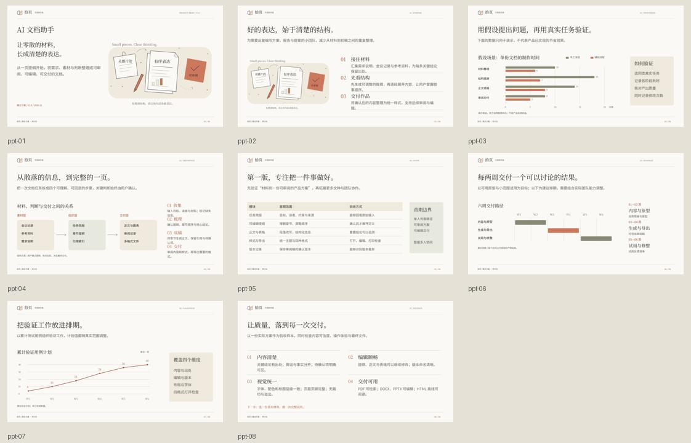

<p align="center">
  
</p>

# 克劳德设计 · Anthropic Design Style

**给思想，留出呼吸的空间。**

一套可安装的中文文档设计技能。用暖纸、宋体、墨线与克制的陶土色组织内容，让同一种设计语言，在 HTML、PDF、DOCX、PPTX 中形成各自的阅读节奏。

[](docs/media/design-philosophy.mp4)

*40 秒完整循环 GIF · 点击查看有声影片 · [观看完整影片](docs/media/design-philosophy.mp4) · [HTML 阅读版](docs/readme.html)*

[快速安装](#快速安装) · [设计哲学](#设计哲学) · [四格式示例](#四格式示例) · [开始创作](#开始创作) · [本地运行](#本地运行)

## 设计哲学

先把思想理清，再决定页面的形状。设计从结论、证据和行动开始，以比例、疏密和清楚的层级，把信息变成可以阅读的表达。

- **内容先行。** 先理解用途与读者，再梳理结构；不为了留白删掉关键内容。
- **留白有度。** 暖纸为阅读留出时间，宋体建立层级，细线连接信息。
- **强调克制。** 陶土色只点亮关键词、编号和转折；正文与版心严格对齐。
- **图形有义。** 插画回应当前主题，图表回答具体问题；真实数据与演示假设清楚区分。

> 以阅读为尺度，让设计退后，让思想向前。

完整规范：[视觉系统](references/design-system.md) · [品牌与主题图形](references/art-direction.md) · [密度与版式库](references/layouts.md) · [格式与验收](references/formats.md)

## 一种语言，四种阅读节奏

| 格式 | 设计目的 | 呈现方式 |
| --- | --- | --- |
| HTML | 连续阅读 | 沿思路展开内容；窄屏重排，宽图表独立横向阅读。 |
| PDF | 一页有一页的秩序 | 用版心、页边、字级和分页，让目光知道在哪里停顿。 |
| DOCX | 思考可以继续 | 原生段落与表格保持稳定层级，便于修改、审阅与协作。 |
| PPTX | 一屏讲清一个重点 | 按讲述拆分长文；观点放大，图文关系替你解释。 |

四格式共用内容、字体、色彩和品牌；信息密度、顺序与页面节奏按载体重新组织。

## 快速安装

### 复制给你的智能体

把下面这句话发给 Codex、Claude Code 或其他能够读写本地文件的智能体：

```text
请将 https://github.com/XiaoyeCodes/Anthropic-Design-Style 中的 anthropic-design-style 技能完整安装到当前智能体支持的 skills 目录，保留 SKILL.md、references、scripts、assets 和 agents。按 README 完成依赖安装与环境检查，再运行四格式示例验证；同名目录已存在时先比较，不覆盖我的修改。
```

### 一条命令安装到 Codex

```bash
npx skills add XiaoyeCodes/Anthropic-Design-Style --skill anthropic-design-style --agent codex -g -y
```

也可以一次安装到多个智能体：

```bash
npx skills add XiaoyeCodes/Anthropic-Design-Style --skill anthropic-design-style --agent codex claude-code cursor -g -y
```

命令采用 [Skills CLI](https://github.com/vercel-labs/skills)，需要 Node.js 22.20+ 与 Git。安装完成后开启新的智能体会话。安装技能会放入规范与脚本；首次运行生成器时，再按下方步骤安装本地运行依赖。

不使用 CLI 时，可下载仓库 ZIP 并把完整目录放入智能体支持的 skills 路径，见 [安装指南](docs/INSTALL.md)。

## 开始创作

复制这段话，附上你的真实材料：

```text
请用 $anthropic-design-style 根据以下材料制作一份中文方案。先梳理结论、证据与行动，再确定品牌和当前主题的原创线稿；沿用暖纸、宋体、墨线与克制的陶土强调。分别为 HTML、A4 PDF、可编辑 DOCX、16:9 PPTX 设计阅读节奏。保留来源与假设标注，最后逐页检查实际渲染。材料如下：……
```

适合方案、研究报告、手册、提案与演示稿。新项目应重新确定品牌与主题插画，不能把案例“拾页”的标记或同一张封面套用到所有主题。

## 四格式示例

案例为「拾页 · AI 文档助手」：同一内容源制作 6 页 A4 阅读稿、8 张 16:9 演示稿、可编辑 Word 与离线网页。案例用于展示版式；其中时间比较是演示假设，六周排期是建议计划。

| 直接查看或下载 | 说明 |
| --- | --- |
| [HTML 示例](examples/showcase/克劳德设计_示例.html) | 离线字体、SVG 线稿、响应式阅读 |
| [PDF 示例](examples/showcase/克劳德设计_示例.pdf) | 6 页，可检索中文 |
| [DOCX 示例](examples/showcase/克劳德设计_示例.docx) | 原生段落与表格，可继续编辑 |
| [PPTX 示例](examples/showcase/克劳德设计_示例.pptx) | 8 张，原生文字、线条与可编辑图形 |
| [内容源 JSON](assets/example.json) | 章节、品牌、主题插画与图表数据 |
| [验证记录](examples/showcase/validation.json) | 页数、中文文本、原生对象与链接检查 |





GitHub 源码页不会直接运行 HTML。下载后用浏览器打开，或在本地启动静态服务即可查看网页效果。

## 本地运行

环境：**Python 3.10+、Node.js 22.20+（含 npm）和 Git**。首次安装依赖需要联网，之后示例生成无需 API Key 或模型服务。

```bash
git clone https://github.com/XiaoyeCodes/Anthropic-Design-Style.git
cd Anthropic-Design-Style
python scripts/bootstrap.py
python scripts/run.py
```

macOS / Linux 若只有 `python3`，将命令里的 `python` 换成 `python3`。脚本自动使用仓库内 `.venv`，不用激活环境。

自定义内容源与输出位置：

```bash
python scripts/run.py --input assets/example.json --out out --name 我的方案
```

`out/` 中会生成四格式文件、品牌与图表素材、PDF 全页预览、PPT 矢量排版证明稿和 `validation.json`。详细依赖、字体与故障处理见 [安装指南](docs/INSTALL.md)。

### 运行与验收边界

- 仓库自带可再分发的中文字体、脚本与示例，不依赖其他技能或本机绝对路径。
- 为使 Office 的字体外观一致，请先安装 `assets/fonts/serif.ttf` 与 `assets/fonts/body.ttf`。PDF 和 HTML 直接使用随文件提供的字体。
- DOCX 正文及表格原生可编辑，插画为图片；PPTX 图表是可编辑形状，不是联动 Excel 数据的原生 Chart。
- 生成器是针对当前案例优化的 **6 页 A4 / 8 张 PPT 参考实现**。新文种、长文或不同数据范围，需要智能体按规范调整布局，不能直接当作通用分页引擎。
- 自动验证检查文件结构与中文文本；Office 的真实分页与外观仍须实际渲染确认。`PPTX_vector-proof.pdf` 是共享场景导出的证明稿，不冒充 Office 导出。

## 仓库里有什么

```text
SKILL.md                 智能体入口与工作方法
agents/                  Codex 展示名称与默认提示语
references/              视觉、主题图形、版式与验收规范
assets/                  内容源、场景图形与 OFL 中文字体
scripts/                 环境安装、四格式生成与验证
examples/showcase/       可直接下载的成品与预览
docs/                    安装指南、HTML 阅读版、影片与 GIF
```

## 来源与许可

这套设计从 **huashu-editorial-docs** 的编辑式文档规范发展而来；README 编排采用 **huashu-md-html** 的设计师模式，影片由 **huashu-motion** 制作。来源与实现边界见 [设计依据](references/sources.md) 和 [第三方说明](THIRD_PARTY.md)。

项目为独立设计方案，与 Anthropic 无隶属或背书关系。项目代码与原创文档采用 [MIT](LICENSE)；随附字体分别采用其 SIL OFL 许可。
